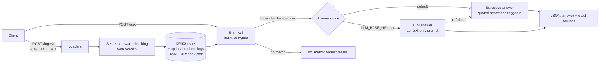

# Document Q&A (RAG) API

[](https://github.com/GEV44/doc-rag-api/actions/workflows/tests.yml)   

A small, self-contained FastAPI service: upload `.txt` / `.md` / `.pdf` files, then ask questions and get an answer **with cited source chunks and scores**. Works with **zero paid services** (BM25 retrieval + extractive answers). An LLM answer step and semantic embeddings are optional and use any OpenAI-compatible endpoint (including local Ollama).

> Bundled `sample_data/` is invented demo data (a fictional clinic, shop, company and product). It contains no real information.

## How it works



## Quickstart

```bash
python -m venv .venv && source .venv/bin/activate     # Windows: .venv\Scripts\activate
pip install -r requirements.txt
uvicorn app.main:create_app --factory --port 8000      # docs at http://localhost:8000/docs
```

Docker: `docker build -t doc-rag-api . && docker run -p 8000:8000 -v ragdata:/data doc-rag-api` (Dockerfile provided; not built or run during authoring, see OVERVIEW.md).

## API

| Method | Path | Purpose |
|---|---|---|
| GET | `/health` | status, document/chunk counts, active retrieval and answer mode |
| POST | `/ingest` | multipart upload, field `files` (repeatable). 415 bad type, 422 empty/unreadable, 413 too big |
| POST | `/ask` | JSON `{"question": "...", "top_k": 3}` -> answer + cited sources |
| GET | `/documents` | list ingested documents |
| DELETE | `/documents/{name}` | remove a document |

Re-uploading a file with the same name replaces it. The index is saved to `DATA_DIR/index.json` and reloaded on start.

## curl examples (real output from a run against `sample_data/`)

```bash
curl -s localhost:8000/health
# {"status":"ok","version":"0.1.0","documents":0,"chunks":0,"retrieval":"bm25","answer_mode":"extractive"}

curl -s -X POST localhost:8000/ingest \
  -F "files=@sample_data/clinic_faq.md" -F "files=@sample_data/returns_policy.md" \
  -F "files=@sample_data/remote_work_handbook.txt" -F "files=@sample_data/product_manual.md"
# {"ingested":[{"source":"clinic_faq.md","chunks":3,"characters":1058},
#   {"source":"returns_policy.md","chunks":3,"characters":993},
#   {"source":"remote_work_handbook.txt","chunks":3,"characters":965},
#   {"source":"product_manual.md","chunks":2,"characters":876}],"total_chunks":11}

curl -s -X POST localhost:8000/ask -H "Content-Type: application/json" \
  -d '{"question":"How long do I have to return an item for a refund?","top_k":2}'
```
```json
{
  "answer": "Unused items can be returned within 30 days of delivery for a full refund. [1] Original shipping costs are not refunded unless the return is due to our error. [2]",
  "mode": "extractive",
  "sources": [
    {"ref": 1, "source": "returns_policy.md", "chunk_index": 0, "score": 5.9404, "text": "# Brightline Outdoor Gear - Returns Policy. > SAMPLE DATA: ... (full chunk text returned)"},
    {"ref": 2, "source": "returns_policy.md", "chunk_index": 1, "score": 5.8196, "text": "## Refunds. Refunds are issued to the original payment method within 5 to 7 business days ... (full chunk text returned)"}
  ]
}
```
(`text` shortened here for readability; the API returns the whole chunk.)

Second example, `"How many vacation days do employees get?"`:
`"Full-time employees have 24 paid vacation days per year. [1] Vacation requests should be filed at least two weeks ahead for periods longer than five days. [1]"` (top source `remote_work_handbook.txt`, score 5.349).

Out-of-scope question (`"Who won the 1998 football world cup?"`):
```json
{"answer":"I could not find anything relevant to that question in the ingested documents.","mode":"no_match","sources":[]}
```
Wrong file type (`bad.exe`): HTTP 415 `{"detail":"bad.exe: Unsupported file type '.exe'. Allowed: .txt, .md, .pdf"}`.
Before anything is ingested, `/ask` returns `"mode": "empty_index"` with an explanatory message.

## Configuration (env vars, see `.env.example`)

| Var | Default | Meaning |
|---|---|---|
| `DATA_DIR` | `./data` | where `index.json` is stored |
| `CHUNK_SIZE` / `CHUNK_OVERLAP` | 500 / 100 | characters per chunk / overlap carried to next chunk |
| `TOP_K` | 3 | default number of chunks returned |
| `MAX_UPLOAD_MB` | 10 | per-file upload limit |
| `API_KEY` | empty | if set, require header `X-API-Key` on everything except `/health` |
| `LLM_BASE_URL`, `LLM_MODEL`, `LLM_API_KEY` | empty | enable LLM answers via `{base}/chat/completions` |
| `EMBEDDINGS_BASE_URL`, `EMBEDDINGS_MODEL`, `EMBEDDINGS_API_KEY`, `EMBEDDINGS_WEIGHT` | empty / 0.5 | enable hybrid BM25 + cosine retrieval via `{base}/embeddings` |

Local Ollama: `LLM_BASE_URL=http://localhost:11434/v1 LLM_MODEL=llama3.2` and `EMBEDDINGS_BASE_URL=http://localhost:11434/v1 EMBEDDINGS_MODEL=nomic-embed-text`. If you turn embeddings on, re-ingest your documents (vectors are computed at ingest time). If the LLM call fails, `/ask` falls back to the extractive answer and adds a `warning` field.

## Tests

```bash
pip install -r requirements-dev.txt
python -m pytest -q          # 24 tests
python scripts/eval.py       # small retrieval check on the sample corpus
```
The LLM and embeddings paths are tested against mocked HTTP only (see OVERVIEW.md, limitations).

## Layout

```
app/        main.py (routes) chunking.py loaders.py retrieval.py answer.py store.py config.py
tests/      pytest suite      scripts/eval.py   sample_data/ (fictional)
```
